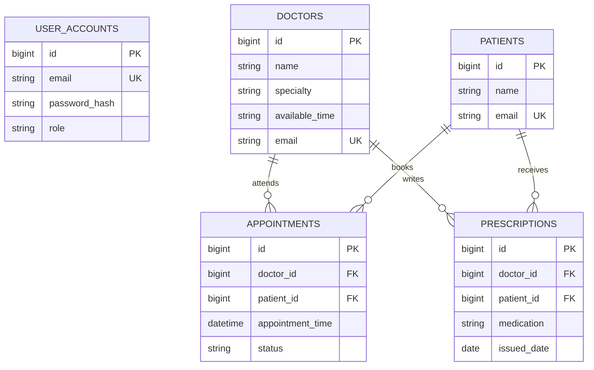

# MySQL database design — Smart Clinic

## Tables and relationships

- `user_accounts(id PK, email UNIQUE, password_hash, role)` — authentication credentials and role (ADMIN, DOCTOR, PATIENT).
- `doctors(id PK, name, specialty, available_time, email UNIQUE)` — doctor directory; `email` joins logically to `user_accounts.email` (not a DB-level FK).
- `patients(id PK, name, email UNIQUE)` — patient directory; `email` joins logically to `user_accounts.email`.
- `appointments(id PK, doctor_id FK, patient_id FK, appointment_time, status)` — a doctor and a patient have many appointments.
- `prescriptions(id PK, doctor_id FK, patient_id FK, medication, issued_date)` — assigned by one doctor to one patient.

## Entity relationship diagram

## Normalization, indexes, constraints

Data is arranged into 3NF-style independent entities; appointments reference providers and patients rather than repeat their details. IDs are bigint auto-increment PKs. Email has a unique constraint. Appointments include indexes on `(doctor_id, appointment_time)` and `(patient_id)` for filtering/reporting. Times are stored as `DATETIME` and assumed clinic-local for this educational demo; production systems should store instants in UTC with explicit timezone policy. Concurrent booking protection should add a dedicated slot uniqueness mechanism (application-level existence check alone has a race).

## Provisioning

`spring.jpa.hibernate.ddl-auto=update` generates entity tables in the sample development setup. `sql/procedures.sql` creates three stored procedures when MySQL container initializes an empty data volume. Use migrations (e.g., Flyway) and `ddl-auto=validate` in production. The procedure definitions assume Hibernate's snake_case column names. Use `SHOW TABLES;` to inspect actual tables.
